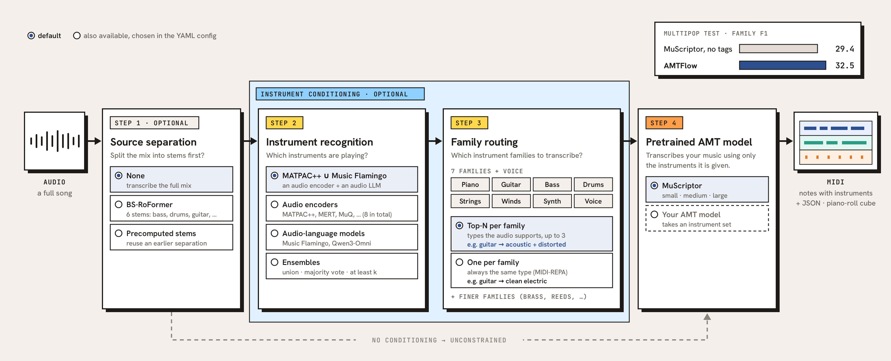

# AMTFlow

[](LICENSE)
[](https://vaclisinc.github.io/AMTFlow/)

AMTFlow is a modular framework for instrument-aware, multi-instrument automatic music
transcription. It recognizes the instruments in a recording, routes them to a pretrained
AMT model as its instrument conditioning, and writes MIDI in which every note carries
its instrument. Source separation is optional; by default the whole mix is transcribed.
Each stage is a pluggable module: source separation, instrument recognition, family
routing and the AMT model itself (MuScriptor by default).

<p align="center">
  <a href="https://vaclisinc.github.io/AMTFlow/">
    
  </a><br>
  <sub>(Click the image to try the live demo.)</sub>
</p>

## Results

On real pop recordings, AMTFlow improves on unconditioned
[MuScriptor](https://github.com/muscriptor/muscriptor), the model it drives, and on
earlier multi-instrument systems. MulTTiPop test set, 392 segments, note-onset F1 ×100,
50 ms ([details](results/multtipop-voice-001/README.md)):

| system | exact instrument | instrument family | instrument-agnostic |
|---|---:|---:|---:|
| MT3 | 10.7 | 15.5 | 28.1 |
| YourMT3+ | 11.5 | 18.9 | 29.3 |
| MuScriptor medium, no instrument tags | 17.2 | 29.4 | 43.0 |
| **AMTFlow** (`default`, same MuScriptor medium) | **18.3** | **32.5** | **44.0** |

- Over MuScriptor, AMTFlow gains **+3.1 family F1** [+2.2, +4.0], **+1.1 exact F1**
  [+0.4, +1.8] and **+1.0 instrument-agnostic F1** [+0.3, +1.8] (95% CIs, paired
  bootstrap over segments). It assigns notes to the right instruments and finds more of
  them.
- Each module can be swapped, so AMTFlow's accuracy rises as instrument identification
  and AMT backbones improve.
- MulTTiPop's references usually write the sung melody on flute, sax or synth lead,
  which penalizes transcribing it as voice. On references with the melody relabelled
  as voice, the family gain is +3.6 ([how the references were corrected](results/multtipop-voice-001/README.md)).
- Solo guitar ([GuitarSet](results/guitarset05-configs-001/README.md), player 05):
  onset F1 0.85. Instrument tagging
  ([OpenMIC-2018](results/openmic-encoder-probe-001/README.md)): 8 frozen encoders
  compared, with published heads.

## Quickstart

```bash
git clone https://github.com/vaclisinc/AMTFlow && cd AMTFlow && uv sync
uv run amtflow transcribe song.wav --out out/
# song.wav: 131 notes; mix: acoustic_piano, acoustic_guitar, electric_bass, drums -> out/clips/song.mid
```

Weights download on first use. MuScriptor is gated: accept its terms on
[Hugging Face](https://huggingface.co/MuScriptor/muscriptor-medium) and run
`hf auth login` once. The default pipeline needs a CUDA GPU with about 18 GB of free
memory.

### With a coding agent

Paste this into Claude Code, Codex or any coding agent, with your file paths filled in:

```text
Set up AMTFlow (https://github.com/vaclisinc/AMTFlow) and transcribe my audio.
1. Clone it, read AGENTS.md and docs/usage.md, and install it with `uv sync`.
2. Check that a CUDA GPU with about 18 GB free is available and that I am logged in
   to Hugging Face with access to MuScriptor/muscriptor-medium. If not, tell me
   exactly what to do and stop.
3. Run `uv run amtflow transcribe <files> --out out/` with the default config.
4. For each file, report the detected instruments, the number of notes and the
   path of the MIDI file.

My audio files: <paths>
```

## The framework

The figure above is the whole pipeline. Each step is a module you pick in a YAML config:

- **Source separation** (optional): none, BS-RoFormer stems, or stems you separated earlier.
- **Instrument recognition**: MATPAC++ ∪ Music Flamingo by default; also 8 audio
  encoders, Qwen3-Omni, or a vote over several recognizers.
- **Family routing**: 7 instrument families plus voice; for each one, the instruments
  the audio supports (top-N) or one fixed instrument.
- **AMT model**: MuScriptor (small, medium or large), or your own model that accepts
  an instrument set.

Skip steps 2 and 3 and the AMT model runs unconstrained. Adding a model takes a class
and a config entry ([docs/extending.md](docs/extending.md)). Every module and option is
listed in [docs/usage.md](docs/usage.md#all-modules).

## Recipes

`--config` takes one of these, or your own YAML that starts with `extends: default.yaml`.

| recipe | what it does |
|---|---|
| `default` | the setup above; best on full songs |
| `paper` | the MIDI-REPA pipeline: made for vocal-removed music, so no voice; one instrument per family, MuScriptor large |
| `fast` | about 6x faster, about 1 F1 point lower |
| `stems`, `stems-click` | separate stems first; one MIDI part per stem (`uv sync --extra separation`) |
| `vote` | majority vote of several recognizers |
| `fine`, `fine-voice` | finer families such as brass, reeds, organ, voice |

## Resources

- **Instrument-recognition heads**: [vaclis/amtflow](https://huggingface.co/vaclis/amtflow)
  on Hugging Face. OpenMIC-2018 heads for 8 frozen audio encoders, used by the `probe`
  recognizer (`head: openmic/<encoder>-mlp`) and downloaded automatically.
- **Benchmark results**: [`results/`](results/): GuitarSet, MulTTiPop and OpenMIC-2018,
  each with its protocol, per-item scores and configs.

## License

The code is MIT. The default pipeline downloads model weights with
**non-commercial** licenses: MuScriptor (CC BY-NC 4.0) and Music Flamingo (NVIDIA
OneWay Noncommercial). MATPAC++ is Apache 2.0, and the BS-RoFormer weights used by
the stem recipes are CC BY-NC-SA 4.0.

## Citation

AMTFlow is the transcription pipeline of the
[MIDI-REPA paper](https://arxiv.org/abs/2610.20967). If you use it, please cite:

```bibtex
@misc{yu2026midirepa,
      title={MIDI-REPA: Improving Text-to-Music Generation with Symbolic Representation Alignment},
      author={Song-Ze Yu and Fang-Duo Tsai and Yi-Hsuan Yang},
      year={2026},
      eprint={2610.20967},
      archivePrefix={arXiv},
      primaryClass={cs.SD},
      url={https://arxiv.org/abs/2610.20967},
}
```
